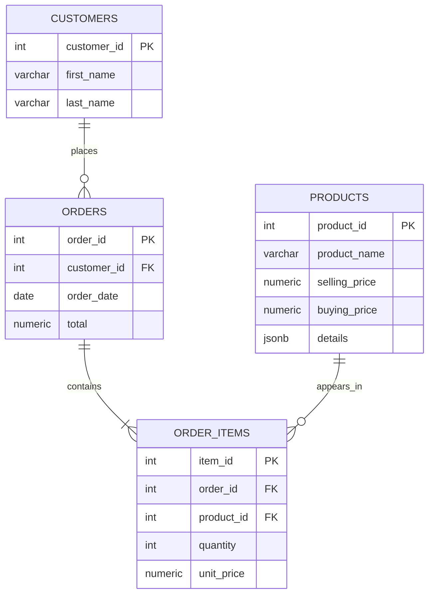

# E-Commerce Analytics Data Pipeline

A Python-based e-commerce application that uses PostgreSQL for relational data, MongoDB for shopping carts, and Redis for caching product rankings.

## Technologies

- Python
- PostgreSQL
- MongoDB
- Redis
- Docker
- psycopg2
- PyMongo
- redis-py

## Features

- Customer creation and retrieval
- Product creation, retrieval, updating, and deletion
- Order processing with transactional operations
- Shopping cart storage and retrieval using MongoDB
- Customer revenue reporting
- Product sales rankings using PostgreSQL window functions
- Redis caching for product rankings
- JSONB product metadata
- Database indexes for query optimization

## Database Design

### ER Diagram



### Schema Explanation

The PostgreSQL database uses four relational tables.

**1. Customers**

Stores customer information.

- `customer_id`: Primary key that uniquely identifies each customer.
- `first_name`: Customer's first name.
- `last_name`: Customer's last name.

**2. Products**

Stores the products available for purchase.

- `product_id`: Primary key.
- `product_name`: Name of the product.
- `selling_price`: Price at which the product is sold.
- `buying_price`: Cost at which the product was acquired.
- `details`: JSONB column for flexible product metadata, such as brand and other product attributes.

**3. Orders**

Stores customer orders.

- `order_id`: Primary key.
- `customer_id`: Foreign key referencing the customer who placed the order.
- `order_date`: Date the order was placed.
- `total`: Total value of the order.

**4. Order Items**

Stores the individual products included in each order.

- `item_id`: Primary key.
- `order_id`: Foreign key referencing the associated order.
- `product_id`: Foreign key referencing the purchased product.
- `quantity`: Number of units purchased.
- `unit_price`: Price of the product when it was ordered.

The `order_items` table resolves the many-to-many relationship between orders and products. An order can contain multiple products, and a product can appear in multiple orders.

### Additional Data Storage

**MongoDB**

Shopping carts are stored in the `carts` collection. Each cart document contains a customer ID and a list of products with their quantities.

**Redis**

Redis caches product sales rankings to reduce repeated database queries. Cached rankings expire after five minutes.

## Query Optimization Report

### 1. B-tree Index on Orders

A B-tree index was created on `orders.customer_id` to support queries that retrieve orders belonging to a particular customer.

```sql
CREATE INDEX idx_orders_customer_id
ON orders (customer_id);
```

The query used for testing:

```sql
EXPLAIN ANALYZE
SELECT *
FROM orders
WHERE customer_id = 1;
```

**Observation:**

Before creating the index, PostgreSQL used a sequential scan to retrieve matching orders.

After creating the index, PostgreSQL continued using a sequential scan because the orders table was small.

This demonstrates that creating an index does not guarantee PostgreSQL will use it. The query planner considers factors such as table size, data distribution, and estimated query cost when choosing an execution plan.

### 2. GIN Index on JSONB Product Metadata

A GIN index can be used to improve queries that search JSONB product metadata.

```sql
CREATE INDEX idx_products_details
ON products USING GIN (details);
```

Example query:

```sql
EXPLAIN ANALYZE
SELECT product_id, product_name, details
FROM products
WHERE details @> '{"brand": "Samsung"}';
```

The JSONB containment operator (`@>`) checks whether the product metadata contains the specified JSON structure.

**Observation:**

The GIN index provides an indexing strategy for JSONB containment searches. PostgreSQL may still choose a sequential scan when the table is small.

### Optimization Summary

| Optimization | Purpose |
|---|---|
| B-tree index | Supports searches by customer ID in orders |
| GIN index | Supports JSONB metadata containment searches |
| Redis caching | Reduces repeated database queries for product rankings |

## Project Setup

### 1. Clone the Repository

```bash
git clone <repository-url>
cd ecommerce_analytics
```

### 2. Install Dependencies

```bash
python -m pip install -r requirements.txt
```

### 3. Configure Environment Variables

Create a `.env` file in the project root:

```env
POSTGRES_PASSWORD=your_password
```

### 4. Start the Databases

Start the PostgreSQL, MongoDB, and Redis containers using Docker Compose:

```bash
docker compose up -d
```

### 5. Run the Application

```bash
python main.py
```

## Project Structure

```text
ecommerce_analytics/
│
├── schemas/
│   ├── customers.py
│   ├── products.py
│   ├── orders.py
│   └── order_items.py
│
├── tests/
│
├── main.py
├── connection.py
├── customers.py
├── products.py
├── orders.py
├── cart.py
├── mongo_connection.py
├── redis_connection.py
├── requirements.txt
├── docker-compose.yml
├── .env
└── README.md
```

